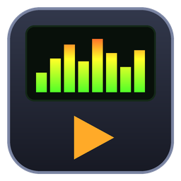

<p align="center"></p>

# RetroAmp

**Trình nghe nhạc & xem phim nhẹ cho Windows, theo phong cách các player huyền thoại thời Windows XP** — LCD xanh lá, nút bấm nổi, thanh EQ dọc, playlist nền đen chữ xanh… nhưng có thêm những thứ của thời nay: **phát YouTube & SoundCloud**, visualizer **cặp loa đập theo nhạc**, crossfade, karaoke.

> A lightweight retro-style music & video player for Windows with YouTube/SoundCloud streaming, a 10-band EQ, effects and visualizers.

## Tải về

Vào trang **[Releases](../../releases/latest)**:

| File | Dùng khi |
|---|---|
| `RetroAmp-x.y.z-Setup.exe` | Cài đặt bình thường (không cần quyền admin, có shortcut + "Open with") |
| `RetroAmp-x.y.z-Portable.zip` | Bản portable: giải nén ở đâu cũng chạy, thiết lập lưu cạnh file exe (USB được) |

Yêu cầu: **Windows 10/11** (đã có sẵn .NET Framework 4.8 — app chỉ ~2 MB). Windows 7/8.1 cần cài [.NET Framework 4.8](https://dotnet.microsoft.com/download/dotnet-framework/net48).

## Tính năng

- 🎵 **Nhạc local**: MP3, FLAC, M4A/AAC, ALAC, WMA, WAV, AIFF, OGG/Opus*
- 🎬 **Video**: MP4, MKV, AVI, WMV, MOV, WebM*, TS… (cửa sổ video riêng, double-click để full screen)
- 🌐 **YouTube & SoundCloud**: dán link bài hát / playlist / kênh / set, hoặc **tìm kiếm** ngay trong app; YouTube có thể mở dạng video. Tự tải trước bài kế tiếp để chuyển bài mượt. Cũng nhận link radio internet / file media trực tiếp.
- 🎚️ **Mix**: EQ 10 băng (60 Hz → 16 kHz) + preamp, 20+ preset (Rock, Pop, Dance, Bass Boost, Bolero…) và lưu preset riêng; **Reverb**, **Stereo width**, **Karaoke** (khử giọng hát giữa), **Crossfade** 0–10 s, limiter chống vỡ tiếng.
- 🔊 **Visualizer**: *Speakers & VU Meters* (cặp loa với màng loa bass phập phồng, đèn LED theo nhịp, kim VU analog), *Spectrum Analyzer* cổ điển, *Oscilloscope*, *Radial Pulse*, *Starfield*. Mini-visualizer trong màn LCD (click để đổi kiểu). Khi xem video, visualizer vẫn chạy (WASAPI loopback).
- 📃 **Playlist**: kéo-thả file/thư mục/link, tìm kiếm, sắp xếp, xóa trùng, lưu/mở M3U/M3U8/PLS, tự nhớ playlist khi tắt.
- ⌨️ Phím tắt kiểu cổ điển (`Z X C V B`), **phím media** trên bàn phím hoạt động toàn cục, nút Prev/Play/Next trên thumbnail taskbar, chỉnh kích thước 100–200%, luôn ở trên cùng, chọn thiết bị âm thanh.

\* Một số định dạng cần codec miễn phí từ Microsoft Store (Web Media Extensions, HEVC, AV1).

### YouTube / SoundCloud hoạt động thế nào?
RetroAmp dùng công cụ mã nguồn mở [yt-dlp](https://github.com/yt-dlp/yt-dlp). Lần đầu bạn mở link online, app hỏi và tự tải `yt-dlp.exe` (~18 MB) vào thư mục Tools. Nếu YouTube thay đổi và không phát được: **Menu → Online → Update yt-dlp**. Với YouTube, có thể cài thêm **Deno** (menu Online) để yt-dlp lấy đầy đủ định dạng.

## Phím tắt

| Phím | Chức năng | Phím | Chức năng |
|---|---|---|---|
| `Z` | Bài trước | `S` | Shuffle |
| `X` | Play | `R` | Repeat (off / all / one) |
| `C` | Pause | `E` / `P` / `K` | Hiện EQ / Playlist / Visualizer |
| `V` | Stop | `L` / `Shift+L` | Thêm file / thư mục |
| `B` | Bài sau | `Ctrl+U` | Thêm link / tìm YouTube, SoundCloud |
| `Space` | Play/Pause | `Ctrl+F` | Tìm trong playlist |
| `←` `→` | Tua 5 giây | `Ctrl+T` | Luôn ở trên cùng |
| `↑` `↓` | Âm lượng | `Ctrl+V` | Dán link vào playlist |

## Build từ mã nguồn

Cần [.NET SDK 8+](https://dotnet.microsoft.com/download) (build được cả trên Windows, Linux, macOS vì UI viết thuần C#, không biên dịch XAML):

```bash
dotnet build src/RetroAmp/RetroAmp.csproj -c Release
# chạy self-test (chỉ trên Windows): giải mã âm thanh, render UI + visualizer ra PNG
src/RetroAmp/bin/Release/net48/RetroAmp.exe --selftest out
```

Release được tạo tự động bởi GitHub Actions khi push tag `v*` (build → self-test → zip portable + Inno Setup installer → GitHub Release).

### Cấu trúc
```
src/RetroAmp/
  Audio/   AudioEngine (NAudio WaveOut + mixer), Deck (decoder + fade), DspChain (EQ, reverb, width, karaoke, limiter),
           Analyzer (FFT, beat detection), VisBus, LoopbackTap
  Media/   Player (playlist, shuffle/repeat, crossfade, fallback), YtDlp + Tools (online), PlaylistIO, TagLoader, MediaBackend (video)
  UI/      MainWindow, LCD 7-segment, custom-drawn buttons/sliders, VisualizerView/Window, VideoWindow, dialogs
installer/RetroAmp.iss   Inno Setup script
```

## Giấy phép
MIT. RetroAmp là dự án độc lập, lấy cảm hứng từ phong cách các media player cổ điển; không liên kết với Winamp, jetAudio hay các chủ sở hữu thương hiệu đó. Sử dụng: [NAudio](https://github.com/naudio/NAudio) (MIT), [TagLib#](https://github.com/mono/taglib-sharp) (LGPL), [yt-dlp](https://github.com/yt-dlp/yt-dlp) (Unlicense, tải riêng khi cần). Hãy tôn trọng điều khoản sử dụng của YouTube/SoundCloud và bản quyền nội dung.
