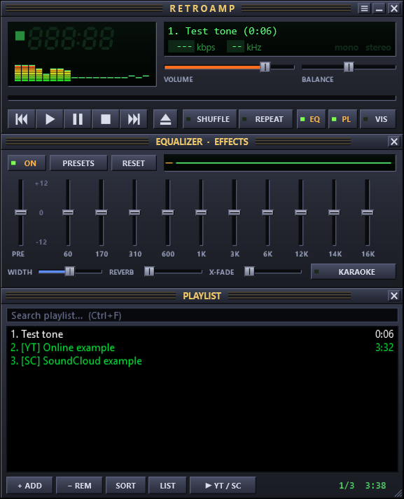
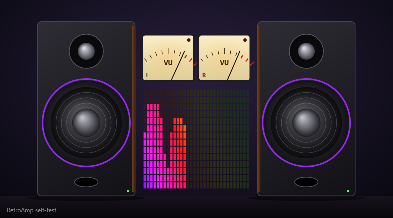
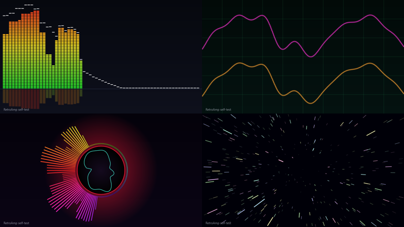
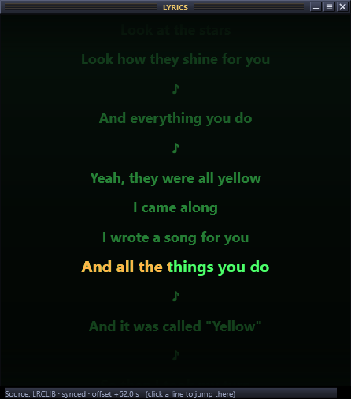
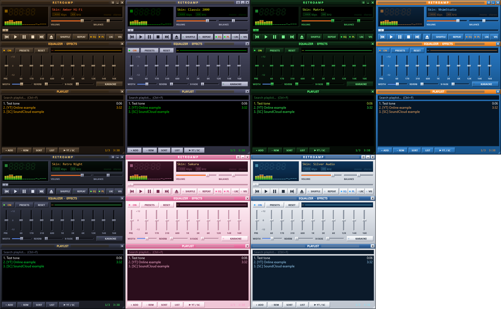
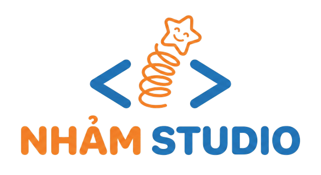

<p align="center"></p>
<p align="center">Phát triển bởi <b>NhảmStudio</b> · <a href="https://topvl.net">https://topvl.net</a></p>

<p align="center"><a href="#retroamp">Tiếng Việt</a> · <a href="#english">English</a></p>

# RetroAmp

**Trình nghe nhạc & xem phim nhẹ cho Windows, theo phong cách các player huyền thoại thời Windows XP** — LCD xanh lá, nút bấm nổi, thanh EQ dọc, playlist nền đen chữ xanh… nhưng có thêm những thứ của thời nay: **phát YouTube & SoundCloud**, visualizer **cặp loa đập theo nhạc**, crossfade, karaoke.

> A lightweight retro-style music & video player for Windows with YouTube/SoundCloud streaming, a 10-band EQ, effects and visualizers.

<p align="center">
  
  <br>
  <br>
  
  
</p>

## Tải về

Vào trang **[Releases](../../releases/latest)**:

| File | Dùng khi |
|---|---|
| `RetroAmp-x.y.z-Setup.exe` | Cài đặt bình thường (không cần quyền admin, có shortcut + "Open with") |
| `RetroAmp-x.y.z-Portable.zip` | Bản portable: giải nén ở đâu cũng chạy, thiết lập lưu cạnh file exe (USB được) |

Yêu cầu: **Windows 10/11** (đã có sẵn .NET Framework 4.8 — app chỉ ~2 MB). Windows 7/8.1 cần cài [.NET Framework 4.8](https://dotnet.microsoft.com/download/dotnet-framework/net48).

## Tính năng

- 🎵 **Nhạc local**: MP3, FLAC, M4A/AAC, ALAC, WMA, WAV, AIFF, OGG/Opus*
- 🎬 **Video**: MP4, MKV, AVI, WMV, MOV, WebM*, TS… (cửa sổ video riêng, double-click để full screen)
- 🌐 **YouTube & SoundCloud**: dán link bài hát / playlist / kênh / set, hoặc **tìm kiếm** ngay trong app; YouTube có thể mở dạng video. Tự tải trước bài kế tiếp để chuyển bài mượt. Cũng nhận link radio internet / file media trực tiếp.
- 🎚️ **Mix**: EQ 10 băng (60 Hz → 16 kHz) + preamp, 20+ preset (Rock, Pop, Dance, Bass Boost, Bolero…) và lưu preset riêng; **Reverb**, **Stereo width**, **Karaoke** (khử giọng hát giữa), **Crossfade** 0–10 s. Nút **AUTO** tự bù mức theo EQ + limiter look-ahead trong suốt → mở to nhạc rock cũng không vỡ/rè (có bài test tự động cho mọi preset).
- 🔊 **Visualizer**: *Speakers & VU Meters* (cặp loa với màng loa bass phập phồng, đèn LED theo nhịp, kim VU analog), *Spectrum Analyzer* cổ điển, *Oscilloscope*, *Radial Pulse*, *Starfield*. Mini-visualizer trong màn LCD (click để đổi kiểu). Khi xem video, visualizer vẫn chạy (WASAPI loopback).
- 🎤 **Lời bài hát chạy theo nhạc** (như jetAudio): tự tìm lyrics có mốc thời gian từ [LRCLIB](https://lrclib.net) hoặc dùng file `.lrc` cùng tên đặt cạnh bài hát. Cửa sổ lyrics kiểu karaoke (dòng đang hát đổi màu dần, bấm vào dòng để tua tới), **lyrics nổi trên desktop** (kéo để di chuyển, lăn chuột để đổi cỡ chữ), chỉnh lệch ±0,5 s cho từng bài, tìm thủ công, nạp file `.lrc`.
- 🎨 **Đổi giao diện (skin)** ngay lập tức: *Retro Night, Classic 2000, Silver Audio, Amber Hi-Fi, Sakura, NhảmStudio, Matrix* — và tự tạo skin riêng bằng file `.ini` (Menu → Skins → *Create my own skin…*).
- 📃 **Playlist**: kéo-thả file/thư mục/link, tìm kiếm, sắp xếp, xóa trùng, lưu/mở M3U/M3U8/PLS, tự nhớ playlist khi tắt.
- ⌨️ Phím tắt kiểu cổ điển (`Z X C V B`), **phím media** trên bàn phím hoạt động toàn cục, nút Prev/Play/Next trên thumbnail taskbar, chỉnh kích thước 100–200%, luôn ở trên cùng, chọn thiết bị âm thanh.

\* Một số định dạng cần codec miễn phí từ Microsoft Store (Web Media Extensions, HEVC, AV1).

### Đổi giao diện
Bấm nút **≡** trên thanh tiêu đề (hoặc chuột phải vào khung player) → **Skins** → chọn skin. Muốn tự làm: **Skins → Create my own skin from the current one…**, đặt tên, Notepad sẽ mở file `.ini` chứa toàn bộ màu (`#RRGGBB`) — sửa, lưu, rồi chọn lại skin đó trong menu. File skin nằm trong thư mục `Skins` (mở nhanh bằng *Open skins folder*); có thể chia sẻ file `.ini` cho người khác.

### Lời bài hát
Bấm nút **LRC** (phím `Y`) để mở cửa sổ lyrics, `Shift+Y` để bật lyrics nổi trên desktop. Lyrics tải về được lưu lại để lần sau mở ngay. Nếu tìm sai bài: chuột phải vào cửa sổ lyrics → *Search lyrics…* để sửa tên ca sĩ/bài hát và chọn kết quả khác; nếu lời chạy nhanh/chậm: *Lyrics later/earlier* (hoặc phím `+` / `−`). Bạn cũng có thể đặt file `Tên bài.lrc` cạnh `Tên bài.mp3`.

### YouTube / SoundCloud hoạt động thế nào?
RetroAmp dùng công cụ mã nguồn mở [yt-dlp](https://github.com/yt-dlp/yt-dlp). Lần đầu bạn mở link online, app hỏi và tự tải `yt-dlp.exe` (~18 MB) vào thư mục Tools. Nếu YouTube thay đổi và không phát được: **Menu → Online → Update yt-dlp**. Với YouTube, có thể cài thêm **Deno** (menu Online) để yt-dlp lấy đầy đủ định dạng. Nếu YouTube báo *"Sign in to confirm you're not a bot"*, vào **Menu → Online → YouTube: use sign-in cookies from browser** và chọn trình duyệt bạn đã đăng nhập YouTube (Firefox ổn định nhất). File tải về được cache để nghe lại không cần tải lại; xóa cache trong cùng menu.

## Phím tắt

| Phím | Chức năng | Phím | Chức năng |
|---|---|---|---|
| `Z` | Bài trước | `S` | Shuffle |
| `X` | Play | `R` | Repeat (off / all / one) |
| `C` | Pause | `E` / `P` / `K` | Hiện EQ / Playlist / Visualizer |
| `V` | Stop | `L` / `Shift+L` | Thêm file / thư mục |
| `B` | Bài sau | `Ctrl+U` | Thêm link / tìm YouTube, SoundCloud |
| `Space` | Play/Pause | `Ctrl+F` | Tìm trong playlist |
| `←` `→` | Tua 5 giây | `Ctrl+T` | Luôn ở trên cùng |
| `↑` `↓` | Âm lượng | `Ctrl+V` | Dán link vào playlist |
| `Y` | Cửa sổ lyrics | `Shift+Y` | Lyrics nổi trên desktop |

## Build từ mã nguồn

Cần [.NET SDK 8+](https://dotnet.microsoft.com/download) (build được cả trên Windows, Linux, macOS vì UI viết thuần C#, không biên dịch XAML):

```bash
dotnet build src/RetroAmp/RetroAmp.csproj -c Release
# chạy self-test (chỉ trên Windows): giải mã âm thanh, render UI + visualizer ra PNG
src/RetroAmp/bin/Release/net48/RetroAmp.exe --selftest out
```

Release được tạo tự động bởi GitHub Actions khi push tag `v*` (build → self-test → zip portable + Inno Setup installer → GitHub Release).

### Cấu trúc
```
src/RetroAmp/
  Audio/   AudioEngine (NAudio WaveOut + mixer), Deck (decoder + fade), DspChain (EQ, reverb, width, karaoke, limiter),
           Analyzer (FFT, beat detection), VisBus, LoopbackTap
  Media/   Player (playlist, shuffle/repeat, crossfade, fallback), YtDlp + Tools (online), PlaylistIO, TagLoader, MediaBackend (video)
  UI/      MainWindow, LCD 7-segment, custom-drawn buttons/sliders, VisualizerView/Window, VideoWindow, dialogs
installer/RetroAmp.iss   Inno Setup script
```

## Tác giả
**NhảmStudio** — https://topvl.net

<p></p>

## Giấy phép
MIT. RetroAmp là dự án độc lập, lấy cảm hứng từ phong cách các media player cổ điển; không liên kết với Winamp, jetAudio hay các chủ sở hữu thương hiệu đó. Sử dụng: [NAudio](https://github.com/naudio/NAudio) (MIT), [TagLib#](https://github.com/mono/taglib-sharp) (LGPL), [yt-dlp](https://github.com/yt-dlp/yt-dlp) (Unlicense, tải riêng khi cần), lời bài hát từ [LRCLIB](https://lrclib.net). Hãy tôn trọng điều khoản sử dụng của YouTube/SoundCloud và bản quyền nội dung.

---

## English

# RetroAmp — a classic-style music & video player for Windows

Made by **NhảmStudio** · https://topvl.net

RetroAmp brings back the feel of classic Windows XP-era players: a green LCD, tactile buttons, vertical EQ sliders and a black-and-green playlist. It also plays YouTube and SoundCloud links, shows animated speaker visualizers and synced lyrics, and offers crossfade and karaoke effects.

### Download

Get the latest version from **[GitHub Releases](../../releases/latest)**:

| File | Best for |
|---|---|
| `RetroAmp-x.y.z-Setup.exe` | Standard installation, no admin rights required; adds a shortcut and an “Open with” option. |
| `RetroAmp-x.y.z-Portable.zip` | Extract and run anywhere, including a USB drive; settings stay next to the executable. |

**Requirements:** Windows 10/11 with .NET Framework 4.8 (included with Windows). Windows 7/8.1 require a separate [.NET Framework 4.8](https://dotnet.microsoft.com/download/dotnet-framework/net48) installation. The app itself is about 2 MB.

### Features

- 🎵 **Local music:** MP3, FLAC, M4A/AAC, ALAC, WMA, WAV, AIFF and OGG/Opus.*
- 🎬 **Video:** MP4, MKV, AVI, WMV, MOV, WebM* and TS in a separate window; double-click for full screen.
- 🌐 **YouTube & SoundCloud:** paste or search for songs, playlists, channels and sets in the app. You can also open internet radio and direct media links. The next track is prefetched for smoother transitions; YouTube videos can open as video.
- 🎚️ **Sound controls:** 10-band EQ (60 Hz–16 kHz) with preamp, 20+ presets and custom presets; reverb, stereo width, center-vocal reduction (“Karaoke”) and 0–10-second crossfade. The AUTO button compensates for EQ/effect gain with a look-ahead limiter.
- 🔊 **Visualizers:** animated Speakers & VU Meters, Spectrum Analyzer, Oscilloscope, Radial Pulse and Starfield. Click the mini-visualizer on the LCD to switch styles; visualizers can keep running during video playback via WASAPI loopback.
- 🎤 **Synced lyrics:** fetch timestamped lyrics from [LRCLIB](https://lrclib.net) or use a matching `.lrc` file. Open the karaoke-style lyrics window or floating desktop lyrics; click a line to seek, adjust timing by ±0.5 seconds, or search and load lyrics manually.
- 🎨 **Skins:** switch between Retro Night, Classic 2000, Silver Audio, Amber Hi-Fi, Sakura, NhảmStudio and Matrix, or make your own `.ini` skin.
- 📃 **Playlist and controls:** drag and drop files, folders or links; search, sort, remove duplicates, save/open M3U/M3U8/PLS, and resume your playlist. Classic `Z X C V B` shortcuts, global media keys, taskbar controls, 100–200% scaling, always-on-top mode and audio-device selection are included.

\* Some formats require free Microsoft Store codecs such as Web Media Extensions, HEVC or AV1.

### Customize a skin

Click **≡** in the title bar (or right-click the player) → **Skins** → choose a skin. To create one, select **Skins → Create my own skin from the current one…**, name it, edit its `#RRGGBB` colors in the `.ini` file opened in Notepad, save, and select it from the menu. Use *Open skins folder* to find and share your skin file.

### Synced lyrics

Press **LRC** (`Y`) for the lyrics window or `Shift+Y` for floating desktop lyrics. Downloaded lyrics are cached. Right-click the lyrics window → *Search lyrics…* to correct an artist/title or choose a different result; use *Lyrics later/earlier* (`+` / `−`) if timing is off. Alternatively, put `Song title.lrc` beside `Song title.mp3`.

### YouTube and SoundCloud playback

RetroAmp uses the open-source [yt-dlp](https://github.com/yt-dlp/yt-dlp). On your first online link, the app asks to download `yt-dlp.exe` (about 18 MB) into its Tools folder. If YouTube changes and playback stops working, use **Menu → Online → Update yt-dlp**. For additional YouTube formats, you can install **Deno** from the Online menu. If YouTube asks you to sign in to confirm you are not a bot, use **Menu → Online → YouTube: use sign-in cookies from browser** and select a browser where you are signed in (Firefox tends to work best). Downloaded media is cached; you can clear the cache from the same menu.

### Keyboard shortcuts

| Key | Action | Key | Action |
|---|---|---|---|
| `Z` | Previous track | `S` | Shuffle |
| `X` | Play | `R` | Repeat (off / all / one) |
| `C` | Pause | `E` / `P` / `K` | Show EQ / playlist / visualizer |
| `V` | Stop | `L` / `Shift+L` | Add file / folder |
| `B` | Next track | `Ctrl+U` | Add link / search YouTube or SoundCloud |
| `Space` | Play/pause | `Ctrl+F` | Search playlist |
| `←` `→` | Seek 5 seconds | `Ctrl+T` | Always on top |
| `↑` `↓` | Volume | `Ctrl+V` | Paste link into playlist |
| `Y` | Lyrics window | `Shift+Y` | Floating desktop lyrics |

### Build from source

Install [.NET SDK 8+](https://dotnet.microsoft.com/download). The C# UI does not compile XAML, so you can build on Windows, Linux or macOS (the app and self-test run on Windows):

```bash
dotnet build src/RetroAmp/RetroAmp.csproj -c Release
# Windows only: audio decoding, UI and visualizer rendering self-test
src/RetroAmp/bin/Release/net48/RetroAmp.exe --selftest out
```

GitHub Actions creates a portable ZIP and Inno Setup installer after a `v*` tag is pushed, following a build and self-test.

### Project layout

```text
src/RetroAmp/
  Audio/   AudioEngine, Deck, DspChain, Analyzer, VisBus, LoopbackTap
  Media/   Player, YtDlp + Tools, PlaylistIO, TagLoader, MediaBackend
  UI/      MainWindow, LCD, custom-drawn controls, visualizers, video window, dialogs
installer/RetroAmp.iss   Inno Setup script
```

### Author and license

**NhảmStudio** — https://topvl.net

MIT. RetroAmp is an independent project inspired by classic media players; it is not affiliated with Winamp, jetAudio or their trademark owners. It uses [NAudio](https://github.com/naudio/NAudio) (MIT), [TagLib#](https://github.com/mono/taglib-sharp) (LGPL), [yt-dlp](https://github.com/yt-dlp/yt-dlp) (Unlicense; downloaded separately when needed), and lyrics from [LRCLIB](https://lrclib.net). Please respect YouTube/SoundCloud terms and content copyrights.
